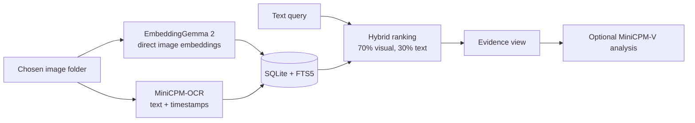

# SightVault

**You remember the image. Not the filename.**

SightVault is a private, fully local visual memory for your screenshots and images. Point it at a folder, then search it the way you remember things: by meaning, by exact text, or by when it first appeared. Open any result and ask a small vision model to explain it. Nothing leaves your machine.

Built in under 3 hours at Penn State's Nittany AI Vibe-a-Thon by Digvijay Singh, Sawan Pandita and [@GoodFrogman7](https://github.com/GoodFrogman7).

## What it does

| Query | Mode | What happens |
| --- | --- | --- |
| "GPU memory problem" | Visual meaning | Finds the CUDA out-of-memory screenshot, with no word "CUDA" in the query |
| "Find ERESOLVE" | Hybrid | Finds the exact npm error through OCR and shows the matched text |
| "CUDA out of memory" + First occurrence | Hybrid | Jumps to the earliest matching file in the index, with its timestamp |
| "Find the image with a red backpack" | Visual meaning | Finds an illustration that contains no text at all |
| "What probably caused this error?" | Analyze | MiniCPM-V explains the selected image, separating what is visible from likely causes |

## How it works



- **Fully local.** Models, index and image copies stay on disk. The server binds to `127.0.0.1` and makes no cloud calls. Only the folder you choose is indexed; there is no screen capture.
- **Embeddings straight from pixels.** EmbeddingGemma 2 produces 768-dimensional image and query vectors with no captioning step.
- **Text extraction.** MiniCPM-OCR 1.0 reads text in each image, with RapidOCR as a labeled fallback.
- **Visual Q&A.** MiniCPM-V 4.7 (1B) answers questions about one selected image on demand.
- **Apple Silicon native.** The MiniCPM models run on MLX Metal; embeddings run on PyTorch MPS in FP32. CPU is supported too.
- **Inputs.** PNG, JPG, WebP, BMP and TIFF, up to 30 MB and 40 megapixels each.

## Quick start (macOS, Apple Silicon)

Requires native ARM Python 3.12 (setup can install it through `uv`) and an internet connection for the one-time model download. After that, everything runs offline.

```bash
cd SightVault
bash Setup-Mac.sh
.venv/bin/python handoff/download_pinned_models.py
.venv/bin/python scripts/prepare_mac_models.py
bash Start-SightVault.command
```

Open <http://127.0.0.1:7861/>. Set `SIGHTVAULT_PORT` to use another port, or `SIGHTVAULT_DEVICE=cpu` to run on CPU. The first search loads the embedding model and takes several seconds; later searches take about 30 ms on an M1 Pro.

Index your own folder from the UI, or from the command line:

```bash
.venv/bin/python scripts/index_folder.py /path/to/screenshots --ocr rapid
```

## Testing

```bash
.venv/bin/python -m pytest tests -q
.venv/bin/python scripts/benchmark.py --offline-check
.venv/bin/python scripts/verify_offline.py
```

Results on an M1 Pro with 16 GB: 123 tests passing (one documented expected failure), 17/17 retrieval cases, 30/30 browser checks, and an offline run with every outbound connection blocked. Details are in [`SightVault/MAC_QA_REPORT.md`](SightVault/MAC_QA_REPORT.md) and [`SightVault/qa/independent-review/FINAL_QA_REPORT.md`](SightVault/qa/independent-review/FINAL_QA_REPORT.md).

## Limitations

- OCR and the 1B vision model can make mistakes. Similarity scores are cosine values, not confidence percentages.
- "First occurrence" means the earliest matching file in your index by file date. It is not proof of when an event happened. The demo images use generated dates.
- PDFs and slides must be exported to images first.

## More

- [`SightVault/README.md`](SightVault/README.md): full setup, models, storage and troubleshooting
- [`SightVault/DEMO.md`](SightVault/DEMO.md): two-minute demo walkthrough

## License

Code is released under the [MIT License](LICENSE). Model weights are downloaded separately and remain under their own licenses: [EmbeddingGemma 2](https://huggingface.co/google/embeddinggemma-2), [MiniCPM-OCR](https://huggingface.co/openbmb/MiniCPM-OCR-1.0), [MiniCPM-V](https://huggingface.co/openbmb/MiniCPM-V-4.7-1B).
